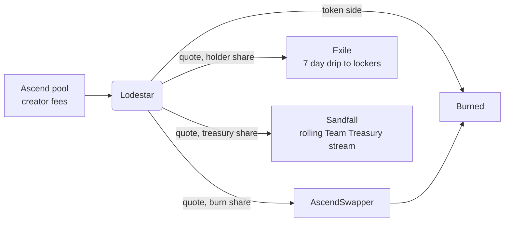

<div align="center">


# Monarchy

### Fee routing, locks and vesting for tokens launched on Ascend

[](https://github.com/monarchy-fi/monarchy/actions/workflows/ci.yml)
[](contracts/test)
[](foundry.toml)
[](https://elysium.kinetiq.xyz/testnet-explorer)
[](#how-it-works)
[](LICENSE)

**Every creator fee burned, bought back, paid to locked holders or streamed to the team in the open. Monarchy takes nothing.**

[Website](https://monarchy.fi) · [Docs](https://docs.monarchy.fi) · [X](https://x.com/monarchyfi) · [Architecture](docs/ARCHITECTURE.md) · [Demo script](docs/DEMO.md) · [Testnet contracts](#live-on-elysium-testnet)

</div>

---

## Why Monarchy

Ascend has no token, and its NFT is capped at 500. People who want a piece of Ascend usually reach for the launchpad's own token, and here there isn't one. Monarchy aims to be that token: a liquid coin whose trading fees flow back to the holders who lock it, built on the same tools it offers every other Ascend project.

On Ascend the creator role collects half of every 1% swap fee, in both the token and the quote asset. Without Monarchy that money sits in one wallet, holders earn nothing for holding, and promises about buybacks or vesting can't be checked on chain. Monarchy replaces those promises with contracts.

## How it works



| | What it does |
|---|---|
| **Lodestar** | A fee router for one Ascend token. The creator launches on Ascend's own site and keeps the dev buy, then hands the token's *creator role* to its Lodestar. Anyone can call `distribute()`: token-side fees are burned, and quote-side fees split by the creator's percentages into **buyback and burn**, **holder rewards** (Exile) and a **Team Treasury** (streamed through Sandfall). Enrols in Ascend's listing set-aside by default. |
| **Exile** | Locks ERC-20s (including v2 LP), ERC-721s and ERC-1155s. Locks can be extended, never shortened, cancelled or transferred. ERC-20 locks earn holder rewards by tier, paid as a 7 day drip, and stop earning the second they unlock. |
| **Sandfall** | Vesting streams (linear, cliff or monthly steps) in any ERC-20 or native HYPE. The creator decides at creation whether a stream can be cancelled, and the site badges it. Rolling streams back Lodestar's Team Treasury. |

### Exile tiers

| Tier | Lock | Multiplier | |
|---|---|---|---|
| Peasant | 1 day | 0.5x | *Everyone starts somewhere.* |
| Knight | 3 days | 1x | *Sworn to the kingdom.* |
| Duke | 7 days | 1.5x | *Next in line.* |
| Monarch | 1 month | 3x | *Steal the crown.* |

No lock, no rewards. With four holders each locking 10,000 tokens and fees dripping at 100 USDC a day, holders who keep re-locking for 30 days earn 250, 500, 750 and 1,500 USDC respectively.

## Security model

- **No upgrades.** Each Lodestar is an EIP-1167 clone of a fixed implementation. Nobody can change its code.
- **No sweep.** There is no rescue or withdraw function. Funds can only go to the burn address, Exile, Sandfall or the swapper.
- **Slow changes.** Split, swapper and slippage changes, and Exile tier changes, wait behind a 12 hour timelock. Settings chosen at activation apply immediately.
- **Locked router.** The creator role can be locked to the Lodestar for a chosen period, so the router can't be swapped out.
- **Guarded buybacks.** The minimum output comes from Ascend's on-chain EMA price, less the pool fee and a slippage allowance (default 10%, max 20%). A skipped buyback stays in reserve and retries on the next distribute; holders and treasury are still paid.
- **Front-run safe activation.** Only the pool's current creator can deploy its Lodestar, at an address derived from the pool id.

See [docs/ARCHITECTURE.md](docs/ARCHITECTURE.md) for the full design and [SECURITY.md](SECURITY.md) to report an issue. The contracts have not been audited yet.

## Live on Elysium testnet

Demo Token (DEMO) is launched on Ascend's live testnet launchpad, with its creator role held by a Lodestar. Burns and buybacks through the real PancakeSwap Infinity pool are confirmed on chain.

| Contract | Address |
|---|---|
| LodestarFactory | [`0x0A9941FBe3cC5f4904AA24D5831ABE073415E1d9`](https://elysium.kinetiq.xyz/testnet-explorer/address/0x0A9941FBe3cC5f4904AA24D5831ABE073415E1d9) |
| Lodestar implementation | [`0x3bD19E9da740c7BE6395a96C23951721D091524A`](https://elysium.kinetiq.xyz/testnet-explorer/address/0x3bD19E9da740c7BE6395a96C23951721D091524A) |
| Exile | [`0x60226465AEf0E05c286E62663431011105A43D23`](https://elysium.kinetiq.xyz/testnet-explorer/address/0x60226465AEf0E05c286E62663431011105A43D23) |
| Sandfall | [`0x6E9f51d47Bbc86BeEafDC90dF725e7B1A2FeAD74`](https://elysium.kinetiq.xyz/testnet-explorer/address/0x6E9f51d47Bbc86BeEafDC90dF725e7B1A2FeAD74) |
| AscendSwapper | [`0x9b9d6A57c2aEd9Bc11e736D5FBa8076458e909bE`](https://elysium.kinetiq.xyz/testnet-explorer/address/0x9b9d6A57c2aEd9Bc11e736D5FBa8076458e909bE) |
| Demo Token (DEMO) | [`0xE224bBb3e7438F096301C7a980402A67cf77BD94`](https://elysium.kinetiq.xyz/testnet-explorer/address/0xE224bBb3e7438F096301C7a980402A67cf77BD94) |
| DEMO Lodestar | [`0x47b8f12CB6ccA74ee14313ade86A15719cc335c7`](https://elysium.kinetiq.xyz/testnet-explorer/address/0x47b8f12CB6ccA74ee14313ade86A15719cc335c7) |

These were deployed before the timelocks moved from 72 to 12 hours, so they still use 72 hours. The next testnet deploy picks up 12.

<details>
<summary>Ascend addresses used</summary>

| | |
|---|---|
| AscendLaunchpad | `0x6d01f6644bbf1b5074472D3e85aa1465B4d2bF3d` |
| ListingDesk | `0x06DbB5eF794BA3C0F6F0ddC6164617Cf21811a77` |
| PancakeSwap Infinity CLPoolManager | `0x12E84206cB53aE0df055482ebc4658635096E1aA` |
| Infinity Vault | `0x2B738A9A69b7a45C9dA6B519f6bE6efBfb912aec` |
| Mock USDC (quote) | `0x84Cc00D13173f7016Bbab22A736dBf75A154cFE2` |

</details>

## Repository layout

```
contracts/src        Lodestar, LodestarFactory, AscendSwapper, Exile, Sandfall, interfaces, mocks
contracts/test       Foundry tests, including a full mock-Ascend integration test
contracts/script     DeployMocks, DeployCore, LaunchOnAscend, ActivateLodestar, DemoFlow
deployments/         <chainId>.json written by the scripts and read by the website
web/                 Vite + React + wagmi site (dashboard, Lodestar, Exile, Sandfall)
docs/                Architecture notes and the demo script
tools/               demo-local.sh, export-abis.mjs, offline solc shim
```

## Quickstart

Needs Node 20+ and [Foundry](https://getfoundry.sh) (`curl -L https://foundry.paradigm.xyz | bash && foundryup`).

```bash
git clone --recursive https://github.com/monarchy-fi/monarchy && cd monarchy
npm install
forge test            # or: npm test
```

In a sandbox that can't download solc, use `FOUNDRY_PROFILE=offline` (wraps the solc npm package).

### Run the demo locally (one command)

```bash
npm run demo:local    # anvil + mock Ascend + Monarchy + a demo launch + Lodestar + demo data
npm --prefix web install
npm run web           # http://localhost:5173
```

Point MetaMask or Rabby at `http://127.0.0.1:8545` (chain 31337) and import anvil's first account to act as the creator. On a dev server, `http://localhost:5173/?mock` connects that account without a browser wallet.

### Deploy to Elysium testnet

Use a **fresh burner wallet**, never your main wallet. Get testnet HYPE from the [Elysium faucet](https://elysium.kinetiq.xyz/testnet-faucet).

```bash
cp .env.example .env     # set PRIVATE_KEY (the burner), keep the Ascend addresses as they are
set -a; source .env; set +a

# 1. Monarchy core: Exile, Sandfall, Lodestar implementation, AscendSwapper, LodestarFactory
npm run deploy:testnet          # writes deployments/99801.json

# 2. A token on Ascend. Either launch on Ascend's site and record it:
TOKEN=0xYourToken npm run launch:testnet
#    or launch from the script (simulate first, then add --broadcast):
npm run launch:testnet
npm run launch:testnet -- --broadcast

# 3. Hand the creator role to the token's Lodestar and activate it (40/40/20 split, the four
#    tiers, 30 day treasury stream, listing set-aside on, creator role locked for a year)
npm run activate:testnet

# 4. The website reads deployments/99801.json
npm run abis && npm run web
```

Mock USDC on Elysium has a public `mint`, so you can fund wallets for trading with
`cast send $QUOTE "mint(address,uint256)" $YOUR_ADDRESS 1000000000000 --rpc-url $RPC_URL --private-key $PRIVATE_KEY`.

If buybacks through the Infinity vault misbehave, Lodestar keeps the buyback share in `buybackReserve` and still pays holders and the treasury. To activate with no buyback route at all, have the factory owner run `setDefaultSwapper(0x0)` before step 3.

## Status and roadmap

| | |
|---|---|
| **Working** | Lodestar, Exile and Sandfall live on Elysium testnet; burns and buybacks proven on Ascend's pool; web app for all three; CI on every change |
| **In progress** | monarchy.fi and public docs, testnet redeploy with 12 hour timelocks, site design |
| **Before launch** | Security audit, mainnet deploy, Monarchy token launch on Ascend |
| **Next** | kHYPE treasury option, TWAP buybacks, Ascend NFT holder bonus in Exile, other launchpads, an indexer for history and APR charts |

Everything works with Ascend as it is today: a creator launches, then hands over the creator role in two steps. An option on Ascend's launch form to pick a Lodestar up front would make it one step.

## License

[MIT](LICENSE)
